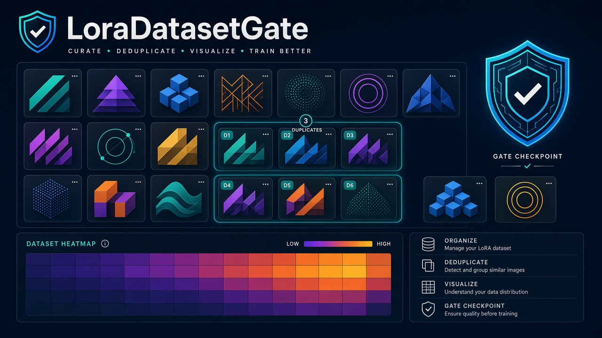
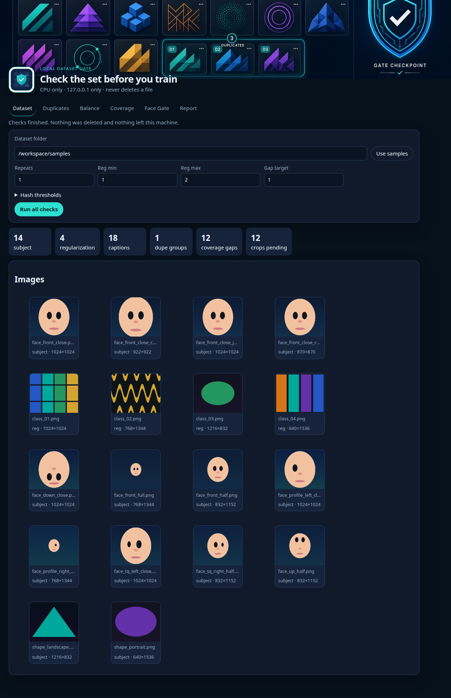
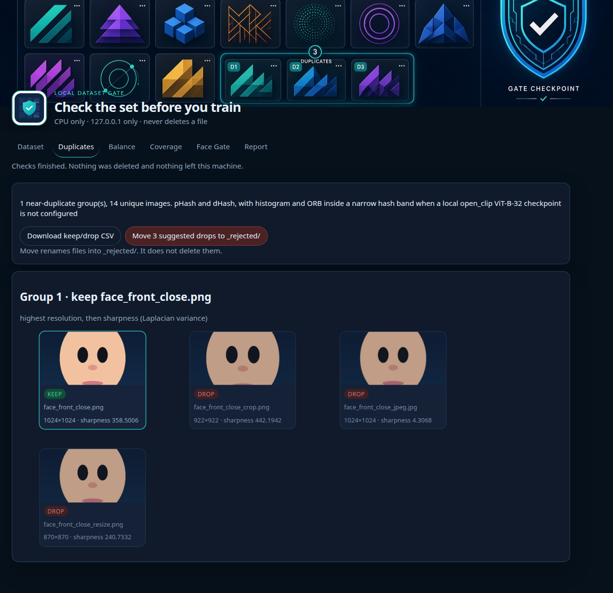
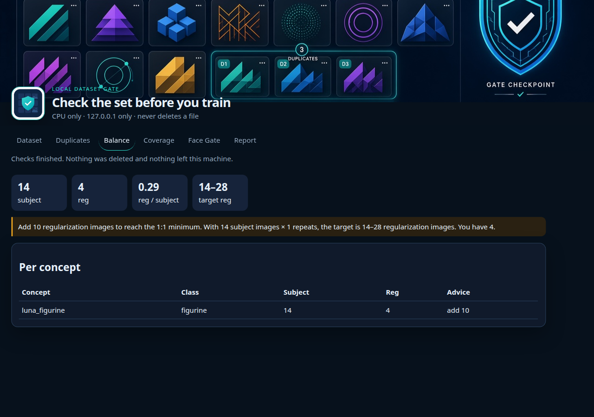
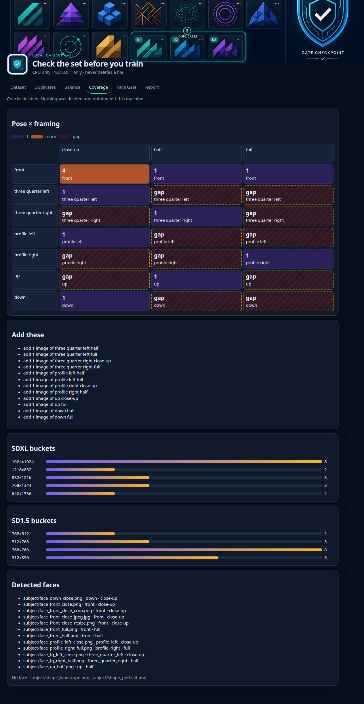
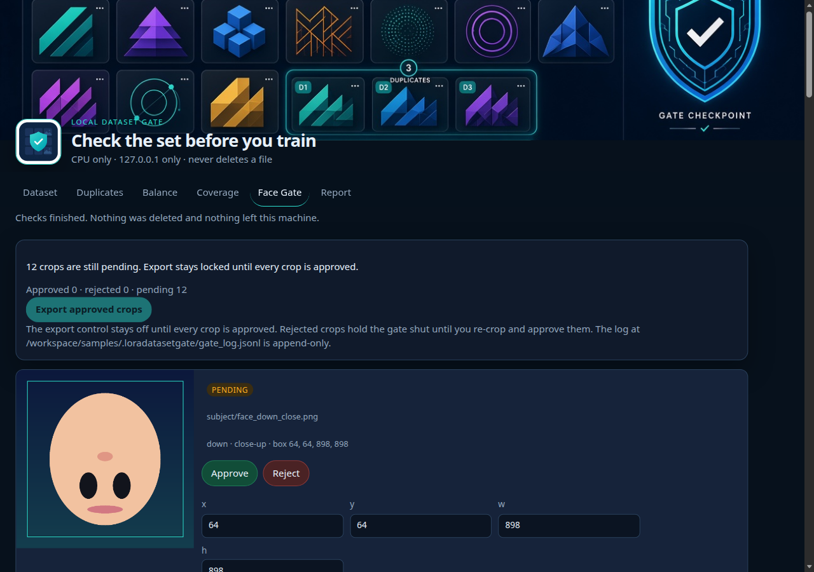
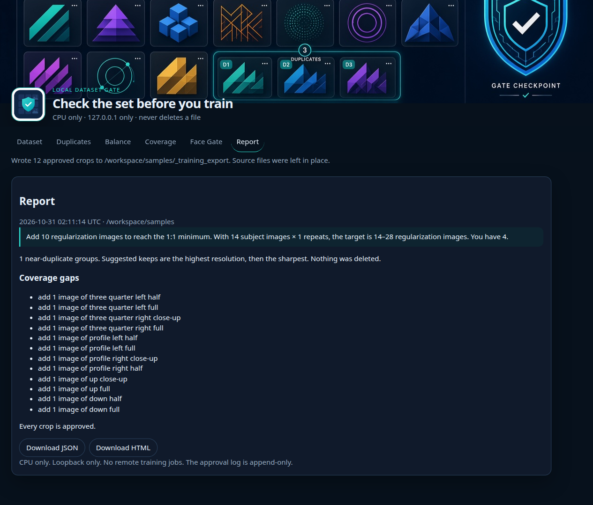
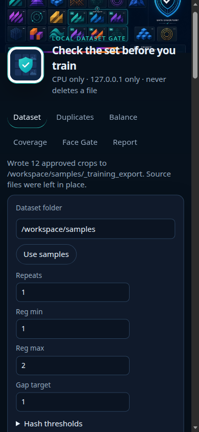

# LoraDatasetGate



LoraDatasetGate checks a LoRA training folder on your machine before you train. Point it at subject images, an optional regularization folder, and caption `.txt` files. It groups near-duplicates, compares subject and class counts, maps pose and aspect-ratio gaps, and holds face crops until you approve every one.

It is one local web app. Checks run on CPU. The server listens on `127.0.0.1` only.

## What it checks

- **NearDupLens** groups images with pHash and dHash. A local open_clip ViT-B-32 checkpoint can be enabled with `LORADATASETGATE_CLIP=1` and `LORADATASETGATE_CLIP_WEIGHTS` pointing at a file on disk. Otherwise color histograms and ORB confirm pairs that are already close in pHash. The suggested keep is the highest resolution, then the highest Laplacian sharpness. A keep/drop CSV can be downloaded. Files move into `_rejected/` only when you confirm that action.
- **RegSetBalancer** counts subject images against regularization images and breaks the count down by caption concept. The default target is 1 to 2 regularization images for each subject image times repeats.
- **PoseCoverageMap and AspectBucketPlanner** estimate head pose (front, three-quarter, profile, up, down) and framing (close-up, half, full), then assign each image to an SDXL and SD1.5 aspect bucket. Empty pose/framing cells are marked and listed as “add N images of …”.
- **FaceCropGate** proposes a crop for every detected face. Approve, reject, or re-crop each one. Export stays locked until every crop is approved, and only approved crops are written. Decisions append to `.loradatasetgate/gate_log.jsonl` (timestamp, file, crop box, hash, decision). The log is never rewritten.

Tabs: Dataset, Duplicates, Balance, Coverage, Face Gate, Report. **Run all checks** fills every tab and builds an HTML or JSON report.

## Screenshots















## Quick start

Python 3.11 or newer. The first launch installs packages. After that, dataset checks do not open outbound connections.

**macOS.** Double-click [`launch-mac.command`](launch-mac.command). The script creates `.venv`, installs dependencies, starts the server on `127.0.0.1:8765`, and opens the browser. The window icon and header use [`art/icon.png`](art/icon.png) and [`art/cover.png`](art/cover.png).

**Windows.** Double-click [`launch-windows.bat`](launch-windows.bat). It does the same with `py -3` or `python`, then opens `http://127.0.0.1:8765/`.

**Linux.**

```bash
chmod +x launch-linux.sh
./launch-linux.sh
```

**From a terminal, any OS.**

```bash
python -m venv .venv
source .venv/bin/activate   # Windows: .venv\Scripts\activate
pip install -r requirements.txt
python scripts/make_samples.py
python -m loradatasetgate
```

Then open http://127.0.0.1:8765/ and choose **Use samples**, or paste your own dataset path.

A dataset folder can keep subject images at the top level or under `subject/`, and regularization images under `reg/`, `class/`, or `regularization/`. Captions are sidecar `.txt` files. Tags such as `concept: luna_figurine, class: figurine, pose: front, framing: close-up` drive the balance and coverage reports.

## Safety

- CPU only. No GPU work is queued.
- The process binds to loopback. A socket guard rejects other outbound connections while the server is running.
- The app does not delete files. Moving a duplicate renames it into `_rejected/` and only after you confirm. Export copies approved crops into `_training_export/` and leaves the originals in place.
- Face export is refused while any crop is pending or rejected. Re-crop a rejected box, then approve it, to clear the lock.
- `gate_log.jsonl` is opened append-only.
- `samples/` is procedural: gradients, stripes, blocks, and cartoon ellipses. There are no photographs of people, no children’s data, and no secrets. See `samples/SYNTHETIC.txt`.

## Tests

```bash
pip install -r requirements-dev.txt
pytest
```

The suite covers hash grouping, ratio math, bucket assignment, heatmap gaps, the export lock, the append-only log, a UI smoke test through the HTTP API, and a check that analysis opens no sockets. GitHub Actions runs the same suite on push.

Optional embedding weights stay on disk. Nothing in the checker downloads a model.
